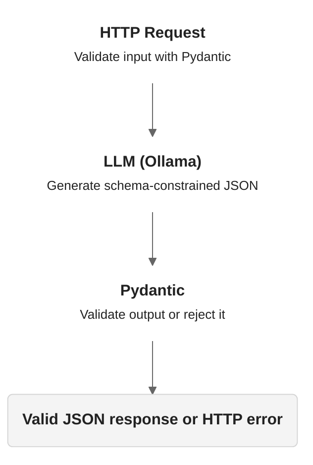

# Goal

Turn an unpredictable LLM into an API with a predictable contract.



## Utility: Classifier

I'll build a support-ticket classifier.

Input:

```json
{ "text": "The login button does not work" }
```

Expected output:

```json
{ "category": "bug" }
```

Send a request:

```sh
curl -s localhost:8000/classify \
  -H "Content-Type: application/json" \
  -d '{"text":"Please add dark mode"}'
```

Expected output:

```json
{ "category": "feature" }
```
