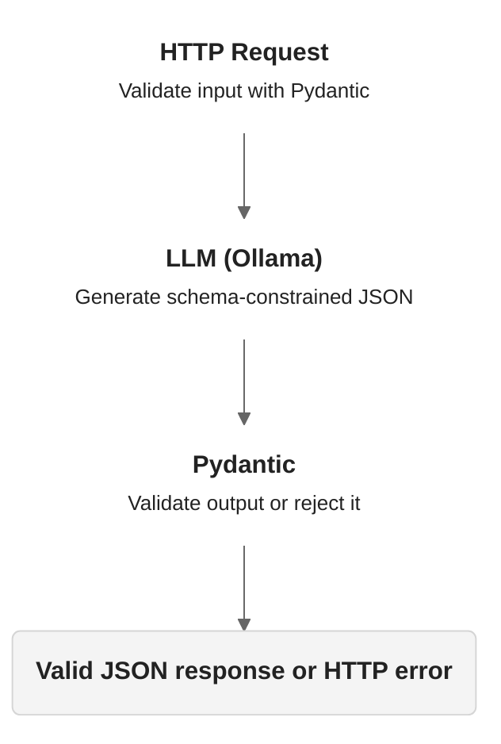

# Predictability

Predictable API contracts around nondeterministic models.



## Stack

- Python / FastAPI
- Pydantic
- Ollama
- uv / pytest

## Run

```bash
uv sync
ollama pull qwen3:4b
uv run uvicorn main:app --reload
```

Requires a running Ollama server.

## API

Input:

```json
{ "text": "The login button does not work" }
```

Output:

```json
{ "category": "bug" }
```

Send a request:

```sh
curl -s localhost:8000/classify \
  -H "Content-Type: application/json" \
  -d '{"text":"Please add dark mode"}'
```

Expected output:

```json
{ "category": "feature" }
```

Allowed categories: bug, feature, question, other.

## Contracts

- Input: nonempty text, maximum 2000 characters
- Output: strictly validated JSON schema
- Invalid input: HTTP 422
- Invalid model output: HTTP 502

## Tests

```bash
uv run pytest -v
```

Tests mock Ollama to verify API behavior independently
of model availability.

## Limitations

- Schema validity does not guarantee semantic correctness.
- Temperature 0 does not guarantee determinism.
- Whitespace-only input is currently accepted.
- Ollama transport errors and timeouts are not yet handled.
